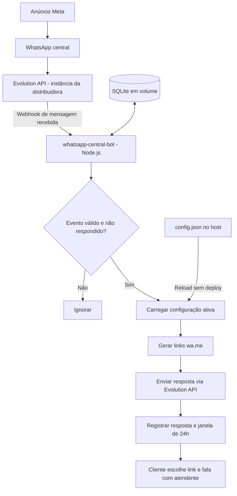

# SPEC — DigiArk WhatsApp Central | Distribuidoras

**Status:** proposta para implementação e homologação

**Versão:** 1.0 — 14/10/2026
**Empresas:** HBA Distribuidora, HB2A Distribuidora e Salbu Foods

## 1. Objetivo

Disponibilizar um número central de WhatsApp por distribuidora, anunciado em campanhas, que responda automaticamente à primeira mensagem recebida com uma saudação e **três links clicáveis** para conversar com atendentes humanos. A solução não realiza atendimento comercial, qualificação, roteamento por região, consulta de estoque nem utiliza IA.

O objetivo é padronizar e agilizar o encaminhamento. **Não há promessa de redução do CPC ou do custo cobrado pela Meta**; a existência de uma etapa adicional pode afetar a conversão.

## 2. Escopo funcional

### RF-01 — Múltiplas distribuidoras
- Suportar três instâncias de WhatsApp da Evolution API inicialmente, com possibilidade de adicionar outras por configuração.
- Cada instância possui sua própria saudação, atendentes e parâmetros.
- Identificar a distribuidora a partir do nome da instância presente no evento recebido; rejeitar instâncias desconhecidas.

### RF-02 — Resposta automática
- Ao receber mensagem direta de cliente, enviar uma mensagem de texto com saudação e três links `https://wa.me/<numero>?text=<mensagem_codificada>`.
- A mensagem deve identificar claramente cada atendente, sem exigir que o cliente responda com opções numeradas.
- O envio depende de uma mensagem efetivamente recebida; **o simples clique no anúncio não dispara resposta automática**.
- Não responder a mensagens de grupos, status, mensagens enviadas pelo próprio número, eventos não suportados ou contatos ignorados.

### RF-03 — Antirrepetição
- Enviar a saudação apenas uma vez por contato, por instância, dentro de uma janela configurável (padrão: 24 horas).
- Chave lógica: `instancia + identificador_normalizado_do_contato`.
- Evitar duplicidade de processamento do mesmo ID de mensagem, inclusive após reentregas do webhook.
- Persistir estado mínimo em armazenamento externo ao processo, de modo a sobreviver a reinícios; para MVP, usar SQLite em volume Docker, com acesso serializado por uma única réplica.
- Mensagens posteriores durante a janela não recebem resposta automática.

### RF-04 — Configuração sem deploy
- Configuração em JSON externo montado como volume **somente leitura** no container.
- Atualizar números, nomes, mensagens e instâncias editando o arquivo no host, sem rebuild ou reinício do container.
- Recarregar por verificação periódica do `mtime` (por exemplo, a cada 5 segundos) e leitura atômica; não depender exclusivamente de eventos de filesystem de volumes Docker.
- Validar o arquivo completo antes de aplicar alterações. Se inválido, manter a última configuração válida e registrar erro sem expor segredos.
- Publicar alterações no host por gravação de arquivo temporário e substituição atômica (`rename`) quando o filesystem permitir.
- Expor no log a versão ou hash da configuração ativa, sem divulgar dados sensíveis.
- Segredos da Evolution API e token do webhook permanecem em variáveis de ambiente/segredos, **não** no arquivo editável de atendentes.

### RF-05 — Atendimento humano
- O cliente escolhe um link e abre o WhatsApp do atendente.
- O sistema não transfere conversas automaticamente nem afirma que o cliente concluiu o contato.
- Mensagens pré-preenchidas podem identificar a distribuidora e a origem da campanha, sem dados pessoais desnecessários.

## 3. Exemplo da mensagem

> Olá! 👋 Bem-vindo à HBA Distribuidora.
>
> Para agilizar seu atendimento, escolha um dos nossos atendentes:
>
> 👤 Atendimento 1: https://wa.me/55DDDNÚMERO1?text=...
>
> 👤 Atendimento 2: https://wa.me/55DDDNÚMERO2?text=...
>
> 👤 Atendimento 3: https://wa.me/55DDDNÚMERO3?text=...
>
> Basta tocar no link do atendente desejado.

**Nota:** os números apresentados no diagrama anterior não incluem todos os dados necessários para gerar links válidos. Confirmar país, DDD e número completo com o contratante. Os números no exemplo são placeholders.

## 4. Arquitetura



### Componentes
- **Evolution API existente:** conexão e envio/recebimento WhatsApp.
- **whatsapp-central-bot:** Node.js LTS, HTTP (Fastify ou Express), webhook, validação, montagem de mensagens e integração REST com Evolution.
- **Configuração externa:** JSON com instâncias, saudação e lista de atendentes.
- **SQLite em volume:** histórico mínimo de mensagens processadas e cooldown por contato. Uma réplica de aplicação no MVP.
- **Docker Compose:** serviço na mesma rede Docker da Evolution API, com volume de configuração read-only e volume persistente para SQLite.

A URL interna e os endpoints específicos da Evolution devem ser conferidos na versão instalada; não presumir compatibilidade de payload entre versões.

## 5. Exemplo de configuração externa

Arquivo no host: `/opt/digiark/whatsapp-central/config/distribuidoras.json`

```json
{
  "schemaVersion": 1,
  "defaultCooldownHours": 24,
  "companies": [
    {
      "instance": "hba-central",
      "enabled": true,
      "displayName": "HBA Distribuidora",
      "welcomeText": "Olá! 👋 Bem-vindo à HBA Distribuidora. Para agilizar seu atendimento, escolha um dos nossos atendentes:",
      "closingText": "Basta tocar no link do atendente desejado.",
      "agents": [
        { "label": "Atendente 1", "phoneE164": "55DDDNÚMERO1" },
        { "label": "Atendente 2", "phoneE164": "55DDDNÚMERO2" },
        { "label": "Atendente 3", "phoneE164": "55DDDNÚMERO3" }
      ],
      "prefilledText": "Olá! Vim pelo anúncio da HBA Distribuidora e gostaria de atendimento."
    },
    {
      "instance": "hb2a-central",
      "enabled": true,
      "displayName": "HB2A Distribuidora",
      "welcomeText": "Olá! 👋 Bem-vindo à HB2A Distribuidora. Escolha um de nossos atendentes:",
      "closingText": "Toque no link para iniciar a conversa.",
      "agents": [
        { "label": "Atendente 1", "phoneE164": "55DDDNÚMERO1" },
        { "label": "Atendente 2", "phoneE164": "55DDDNÚMERO2" },
        { "label": "Atendente 3", "phoneE164": "55DDDNÚMERO3" }
      ],
      "prefilledText": "Olá! Vim pelo anúncio da HB2A Distribuidora e gostaria de atendimento."
    },
    {
      "instance": "salbu-central",
      "enabled": true,
      "displayName": "Salbu Foods",
      "welcomeText": "Olá! 👋 Bem-vindo à Salbu Foods. Escolha um de nossos atendentes:",
      "closingText": "Toque no link para iniciar a conversa.",
      "agents": [
        { "label": "Atendente 1", "phoneE164": "55DDDNÚMERO1" },
        { "label": "Atendente 2", "phoneE164": "55DDDNÚMERO2" },
        { "label": "Atendente 3", "phoneE164": "55DDDNÚMERO3" }
      ],
      "prefilledText": "Olá! Vim pelo anúncio da Salbu Foods e gostaria de atendimento."
    }
  ]
}
```

**Importante:** `55DDDNÚMERO*` é um marcador explicativo, propositalmente inválido. Substituir por números reais com DDI 55, DDD e número, somente dígitos. Validar com biblioteca apropriada (ex.: libphonenumber-js) antes de ativar a configuração. As empresas e instâncias são nomes de exemplo a confirmar na Evolution.

### Regras de validação
- `schemaVersion` suportado; instâncias únicas; empresas habilitadas com pelo menos um atendente (três no escopo inicial).
- Números em formato internacional válido; sem duplicidade acidental por empresa.
- Textos não vazios, limites razoáveis de tamanho e caracteres especiais codificados na URL.
- Mudança de configuração não reinicia o cooldown de contatos já respondidos.

## 6. Contrato do webhook

- Endpoint interno: `POST /webhooks/evolution`.
- Receber eventos de mensagens recebidas conforme formato efetivo da versão da Evolution instalada.
- Conferir instância, ID da mensagem, remetente e flag `fromMe`.
- Rejeitar requisições não autorizadas: validar mecanismo disponível na instalação (por exemplo, cabeçalho/token ou rede interna restrita). Não expor endpoint publicamente sem autenticação.
- Responder `2xx` rapidamente **após registrar de forma durável o evento**, e processar envio em worker local; alternativamente, se o processamento for síncrono, definir timeouts e semântica de reentrega explícitos.
- Idempotência: evento duplicado não pode gerar duas saudações.
- Falha no envio não deve marcar contato como atendido; permitir tentativas com backoff limitado e logs de falha.
- Em caso de falha entre envio à Evolution e confirmação local, reconhecer que pode haver ambiguidade de entrega; priorizar prevenção de duplicidades e registrar reconciliação operacional.

## 7. Docker e rede

Exemplo ilustrativo de serviço no Compose existente:

```yaml
services:
  whatsapp-central-bot:
    build: ./whatsapp-central-bot
    restart: unless-stopped
    environment:
      NODE_ENV: production
      PORT: 3000
      EVOLUTION_BASE_URL: http://evolution-api:8080
      EVOLUTION_API_KEY: ${EVOLUTION_API_KEY}
      WEBHOOK_SHARED_SECRET: ${WEBHOOK_SHARED_SECRET}
      CONFIG_PATH: /app/config/distribuidoras.json
      SQLITE_PATH: /app/data/state.sqlite
    volumes:
      - /opt/digiark/whatsapp-central/config:/app/config:ro
      - whatsapp-central-state:/app/data
    networks:
      - evolution-net
    # Sem publicação de porta para a internet.

volumes:
  whatsapp-central-state:

networks:
  evolution-net:
    external: true
```

**Ajustar** `evolution-net`, `evolution-api:8080`, chave de API e mecanismo de autenticação à implantação real. A aplicação precisa estar acessível pela Evolution no mesmo Docker network; não é necessário expor porta pública. A aplicação não deve ter acesso desnecessário aos demais serviços da VPS.

## 8. Segurança e privacidade

- Não registrar conteúdo completo de mensagens nem telefones em logs de aplicação; mascarar identificadores.
- Armazenar apenas o mínimo necessário para cooldown, deduplicação e suporte operacional, com retenção configurável e limpeza periódica.
- Proteger arquivos de configuração e segredos com permissões de host apropriadas.
- Restringir webhook à rede interna e autenticar requisições; validar payload e limites de tamanho.
- Prever política de privacidade e base legal apropriada para tratamento dos contatos, com atenção à LGPD.
- Evolution com conexão não oficial ao WhatsApp pode sofrer desconexões ou bloqueios; monitorar instâncias e não prometer disponibilidade equivalente à API oficial.

## 9. Logs e observabilidade

Eventos recomendados: `webhook_received`, `message_ignored`, `duplicate_ignored`, `cooldown_active`, `reply_sent`, `reply_failed`, `config_reloaded`, `config_invalid`, `instance_unknown`.

- `GET /health/live`: processo ativo.
- `GET /health/ready`: configuração válida, banco acessível e dependências internas mínimas disponíveis; acesso restrito à rede interna.
- Contadores por instância: mensagens recebidas, respostas enviadas, falhas e eventos ignorados.
- **Não** inferir cliques nos links `wa.me` ou conversas efetivas com vendedores apenas pelos envios da saudação. Métricas de clique exigem redirecionador próprio, fora deste MVP.

## 10. Critérios de aceite

1. Ao receber a primeira mensagem direta de um contato novo na instância HBA, a aplicação responde com saudação e três links válidos da HBA.
2. HB2A e Salbu respondem com textos e números próprios, sem vazamento de configuração entre empresas.
3. Alterar um telefone no JSON do host atualiza a próxima resposta **sem rebuild e sem reinício** do container.
4. JSON inválido não derruba o serviço; configuração anterior continua ativa e erro é registrado.
5. Mensagens repetidas do mesmo contato durante 24 horas não recebem nova saudação.
6. Reiniciar o container não apaga o controle de cooldown nem gera nova saudação indevida.
7. Reentregar o mesmo evento webhook não gera duas mensagens.
8. Mensagens `fromMe`, grupos e instâncias desconhecidas não produzem resposta.
9. Falha temporária de envio gera retry controlado; não há registro falso de envio bem-sucedido.
10. Serviço responde na rede Docker da Evolution sem publicar endpoint público.
11. Links abrem o WhatsApp do atendente com mensagem pré-preenchida; envio da mensagem depende da ação do cliente.
12. A solução funciona sem OpenClaw, IA, Excel, ERP, n8n ou painel administrativo.

## 11. Fora do escopo

- Agente de IA, interpretação de intenção, menus de múltiplas etapas.
- Identificação de região e consulta a planilhas Excel.
- Consulta de estoque, ERP ou CRM.
- Atendimento humano dentro do número central.
- Distribuição automática ou balanceamento entre vendedores.
- Painel administrativo e editor visual de mensagens.
- Rastreamento de cliques ou atribuição de vendas.
- Integração com API oficial da Meta nesta fase.

## 12. Plano de implementação

**Tarefa 1 — Infraestrutura:** identificar versão da Evolution, nome da rede Docker, endpoints REST, autenticação e payload real de webhook; confirmar que as três instâncias estão conectadas.

**Tarefa 2 — Configuração:** criar esquema JSON, validador e mecanismo de recarga sem reinício.

**Tarefa 3 — Webhook:** implementar recepção autenticada, normalização de eventos, filtros e idempotência.

**Tarefa 4 — Resposta:** montar links `wa.me` com `encodeURIComponent`, chamar Evolution e tratar falhas.

**Tarefa 5 — Persistência:** implementar SQLite, cooldown de 24 horas, fila simples de eventos pendentes e limpeza periódica.

**Tarefa 6 — Container:** Dockerfile multi-stage, Compose, volumes, rede e health checks.

**Tarefa 7 — Testes:** unitários, integração com payload real e homologação dos três números.

**Tarefa 8 — Operação:** documentação para editar o JSON, validar alteração, acompanhar logs e reverter configuração.

## 13. Pendências de confirmação

- Nomes exatos das três instâncias na Evolution API.
- Números completos dos três atendentes de cada empresa (DDI e DDD).
- Texto final de saudação e mensagem pré-preenchida por distribuidora.
- Versão instalada da Evolution API, nome da rede Docker e URL interna do serviço.
- Mecanismo de autenticação de webhook suportado na versão instalada.
- Política desejada de nova saudação após 24 horas (padrão proposto).
- Se todos os três links devem sempre aparecer ou se haverá contatos temporariamente desabilitados.

## 14. Decisão arquitetural

**Recomendação:** Node.js LTS + Fastify + SQLite + JSON externo montado como volume + Docker na rede da Evolution. Um único serviço atende as três empresas, com atualização de números e textos sem deploy. A arquitetura é deliberadamente simples e pode evoluir para painel, métricas de cliques ou banco de dados maior se houver demanda comprovada.
